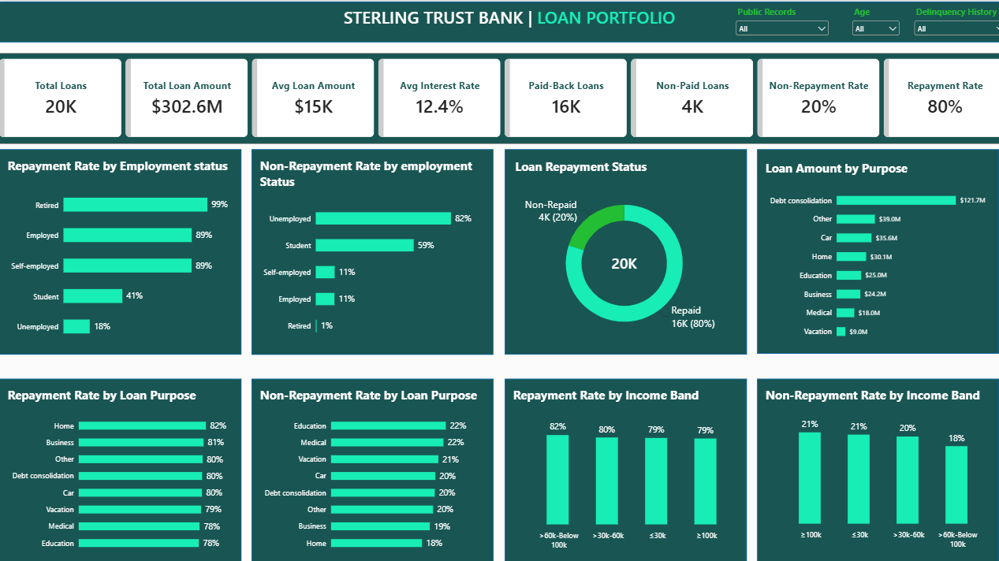
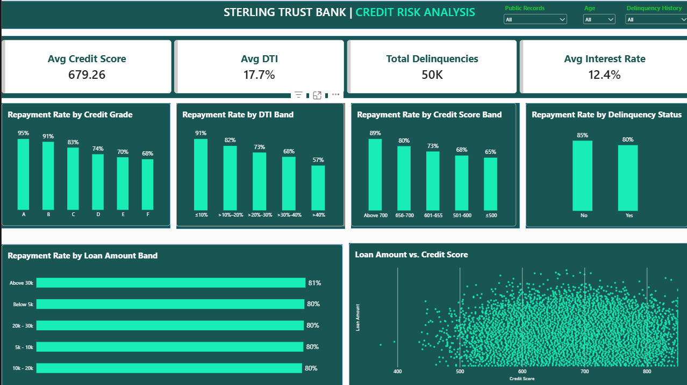
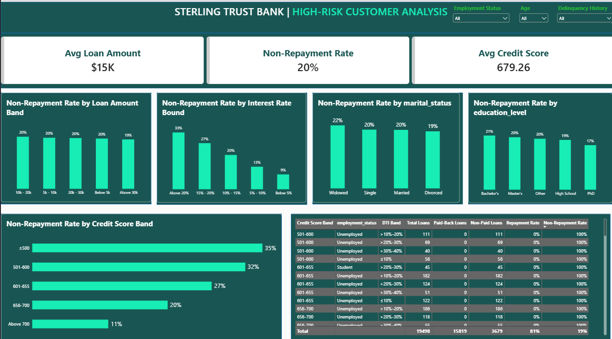
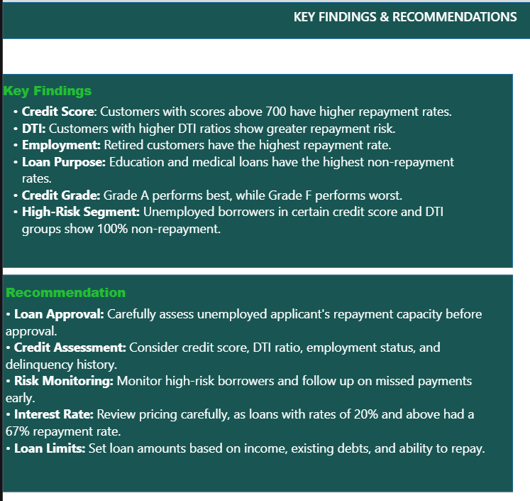
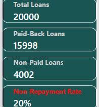
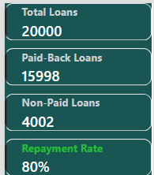
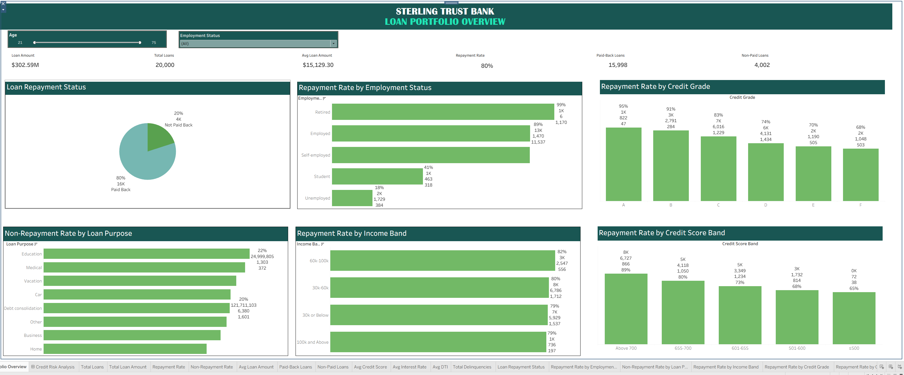
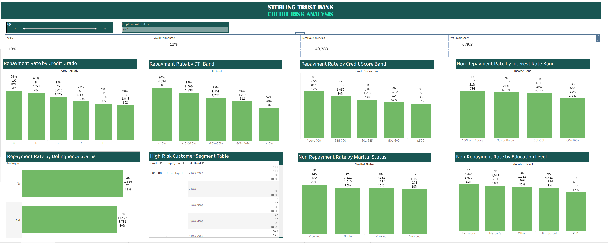

# Sterling Trust Bank | Loan Portfolio & Credit Risk Analysis

## Project Overview
This project analyses 20,000 loan records to evaluate loan repayment performance, identify credit risk patterns, and provide recommendations to improve lending decisions.

**Tools:** MySQL, Excel, Power Query, Power BI, Tableau

## 1. SQL Analysis — MySQL
I used MySQL to explore the dataset, analyse repayment outcomes, and identify patterns across customer and loan characteristics.

I created the following categories to support the analysis:
- **Credit Score Bands:** Grouped borrowers by credit score.
- **DTI Bands:** Categorised debt-to-income ratios.
- **Income Bands:** Grouped borrowers by annual income.
- **Loan Amount Bands:** Categorised loans by amount.
- **Interest Rate Bands:** Grouped loans by interest rate.
- **Credit Grades:** Grouped subgrades (A1–A5, B1–B5, etc.) into their main grades.
- **Delinquency Status:** Classified borrowers based on recorded delinquencies.

## 2. Power BI Dashboard

I used Power Query for data preparation and DAX to create measures and visualise loan performance, repayment rates, and credit risk.

### Loan Portfolio Overview

### Credit Risk Analysis

### High-Risk Customer Analysis

### Key Findings and Recommendations

### Interactive Tooltips

I created custom tooltips for repayment and non-repayment metrics, allowing users to hover over dashboard visuals and view additional details, including total loans, paid-back loans, non-paid loans, and repayment or non-repayment rates.

## 3. Tableau Dashboard

I recreated the analysis in Tableau, building interactive dashboards to explore loan portfolio performance and credit risk.

### Loan Portfolio Overview

### Credit Risk Analysis

## 4. Key Findings

- **Credit Score:** Borrowers with scores above 700 had an 89% repayment rate, compared with 65% for scores below 500.
- **DTI:** Borrowers with low DTI had approximately 91% repayment, while the 40%+ DTI group had a 43% non-repayment rate.
- **Credit Grade:** Grade A recorded a 95% repayment rate, while Grade F recorded 68%.
- **Employment Status:** Retired borrowers recorded 99% repayment. Employed and self-employed borrowers each recorded approximately 89%.
- **Income:** Repayment rates were at least 79% across all income bands.
- **Loan Purpose:** Education and medical loans recorded non-repayment rates of approximately 22%.
- **Loan Amount:** Loans above 30k had an 81% repayment rate, compared with 80% for loans below 5k.
- **Interest Rate:** Loans with interest rates of 20% and above recorded a 67% repayment rate.
- **High-Risk Segments:** Several unemployed borrower segments combining specific credit score and DTI bands recorded 100% non-repayment.

## 5. Recommendations for Sterling Trust Bank

### 1. Improve Loan Approval Decisions
The bank should carefully assess unemployed applicants before approving loans. For example, unemployed borrowers aged 21 had only 5 out of 41 loans paid back, giving a repayment rate of 12%. Similar low repayment rates were observed among unemployed borrowers aged 23 and 24. The bank should review applicants' repayment capacity before approving loans.

### 2. Strengthen Credit Assessment
The bank should consider credit scores, debt-to-income (DTI) ratios, employment status, and delinquency history when assessing applicants. Customers with credit scores above 700 had an 89% repayment rate, while those with scores below 500 had a 65% repayment rate. Customers with DTI ratios of 40% and above also showed higher repayment risk.

### 3. Improve Risk Monitoring
The bank should closely monitor high-risk customer groups, especially unemployed borrowers and customers with high DTI ratios. It should identify early signs of repayment difficulties and contact customers who miss payments to reduce further losses.

### 4. Use Risk-Based Interest Rates
The bank should consider borrowers' credit scores, DTI ratios, and repayment capacity when setting interest rates. Loans with interest rates of 20% and above had a repayment rate of 67%, although this group contained only 15 loans. The bank should consider these repayment patterns when reviewing its interest rate approach.

### 5. Manage High-Risk Customer Segments
The bank should pay closer attention to unemployed borrowers and student borrowers, particularly younger applicants. For example, unemployed borrowers aged 22 had a repayment rate of 30%, while students aged 22 had a repayment rate of 35%. In comparison, self-employed borrowers aged 24 had a repayment rate of 93%, and employed borrowers of the same age had a repayment rate of 87%. These differences highlight the importance of considering employment status and repayment capacity during risk assessment.

### 6. Set Appropriate Loan Limits
The bank should consider applicants' income, existing debts, employment status, and ability to repay when determining loan amounts. Although loans above 30k had an 81% repayment rate compared with 80% for loans below 5k, the difference was small. Therefore, loan limits should be based on individual repayment capacity rather than loan size alone.
